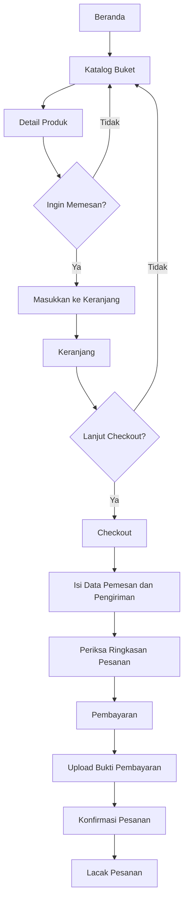
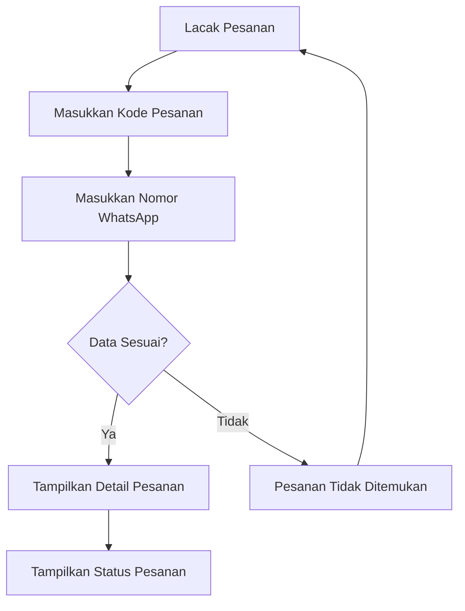
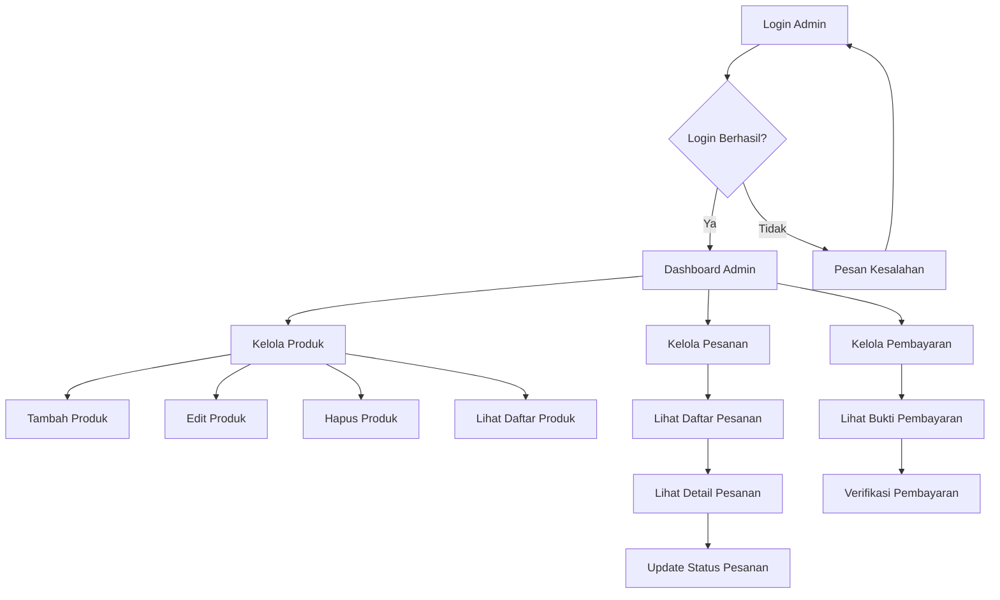

# User Flow Sistem Pemesanan Buket

User Flow merupakan gambaran alur pengguna ketika berinteraksi dengan Sistem Pemesanan Buket Berbasis Web. Diagram ini dibuat berdasarkan latar belakang, tujuan, ruang lingkup sistem, serta 12 wireframe yang telah dirancang. User Flow menggambarkan langkah-langkah yang dilakukan pelanggan dalam melakukan pemesanan dan pelacakan buket, serta aktivitas admin dalam mengelola produk, pesanan, dan pembayaran.

## 1. User Flow Pelanggan

Alur pelanggan dimulai dari halaman beranda, kemudian pelanggan melihat katalog buket, memilih produk, memasukkan produk ke keranjang, melakukan checkout, mengisi data pemesanan, melakukan pembayaran, mengunggah bukti pembayaran, mendapatkan konfirmasi pesanan, dan dapat melacak pesanan.

### Diagram User Flow Pelanggan

### Penjelasan Alur Pelanggan

1. Pelanggan membuka halaman Beranda untuk melihat informasi utama website dan navigasi.
2. Pelanggan masuk ke halaman Katalog Buket untuk melihat pilihan produk dan harga.
3. Pelanggan memilih salah satu produk dan melihat Detail Produk.
4. Jika tertarik, pelanggan memasukkan produk ke Keranjang.
5. Pelanggan memeriksa isi Keranjang, mengubah jumlah produk, atau menghapus produk yang tidak diinginkan.
6. Jika ingin melanjutkan, pelanggan masuk ke halaman Checkout.
7. Pelanggan mengisi data pemesan dan pengiriman, seperti nama, nomor WhatsApp, alamat, serta tanggal pengiriman. Email dapat diisi secara opsional.
8. Pelanggan memeriksa ringkasan pesanan dan total pembayaran.
9. Pelanggan melanjutkan ke halaman Pembayaran untuk melihat informasi pembayaran.
10. Pelanggan melakukan pembayaran dan mengunggah bukti pembayaran.
11. Sistem menampilkan Konfirmasi Pesanan dan kode pesanan.
12. Pelanggan dapat melacak pesanan melalui halaman Lacak Pesanan.

## 2. User Flow Pelacakan Pesanan

Pelacakan pesanan digunakan oleh pelanggan untuk mengetahui perkembangan pesanan tanpa harus membuat akun atau login. Pelanggan memasukkan kode pesanan dan nomor WhatsApp yang digunakan saat melakukan pemesanan.

### Diagram User Flow Pelacakan Pesanan

### Penjelasan Alur Pelacakan Pesanan

1. Pelanggan membuka halaman Lacak Pesanan.
2. Pelanggan memasukkan kode pesanan yang diperoleh saat melakukan pemesanan.
3. Pelanggan memasukkan nomor WhatsApp yang digunakan saat checkout.
4. Sistem memeriksa kesesuaian kode pesanan dan nomor WhatsApp dengan data yang tersimpan.
5. Jika data sesuai, sistem menampilkan detail dan status pesanan.
6. Jika data tidak sesuai atau pesanan tidak ditemukan, sistem menampilkan pesan bahwa pesanan tidak ditemukan.
7. Pelanggan dapat mengulangi pencarian dengan memasukkan data yang benar.

## 3. User Flow Admin

Admin merupakan pengguna yang bertugas mengelola data dan aktivitas pada Sistem Pemesanan Buket Berbasis Web. Admin harus melakukan login terlebih dahulu untuk mengakses dashboard dan fitur pengelolaan sistem.

### Diagram User Flow Admin

### Penjelasan Alur Admin

1. Admin membuka halaman Login Admin.
2. Admin memasukkan username dan password.
3. Sistem memeriksa data login admin.
4. Jika login berhasil, admin masuk ke Dashboard Admin. Jika gagal, sistem menampilkan pesan kesalahan dan admin dapat mencoba kembali.
5. Admin dapat memilih menu Kelola Produk untuk menambah, mengedit, menghapus, dan melihat daftar produk buket.
6. Admin dapat memilih menu Kelola Pesanan untuk melihat daftar pesanan, detail pesanan, dan memperbarui status pesanan.
7. Admin dapat memilih menu Kelola Pembayaran untuk melihat bukti pembayaran yang diunggah pelanggan dan melakukan verifikasi pembayaran.

## 4. Kesimpulan User Flow

User Flow Sistem Pemesanan Buket Berbasis Web menggambarkan alur interaksi pelanggan dan admin dalam menggunakan sistem. Alur pelanggan meliputi melihat katalog, memilih buket, melakukan pemesanan, pembayaran, konfirmasi, dan pelacakan pesanan. Sementara itu, alur admin meliputi login, pengelolaan produk, pengelolaan pesanan, dan verifikasi pembayaran.

User Flow ini digunakan sebagai panduan dalam proses perancangan tampilan website, pengembangan fitur, pengelolaan database, serta pengujian sistem agar proses pengembangan sesuai dengan kebutuhan yang telah direncanakan.

